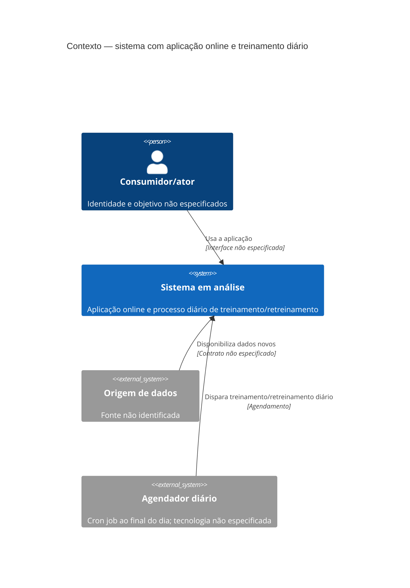
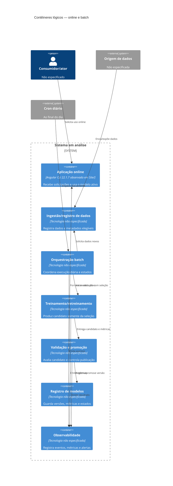
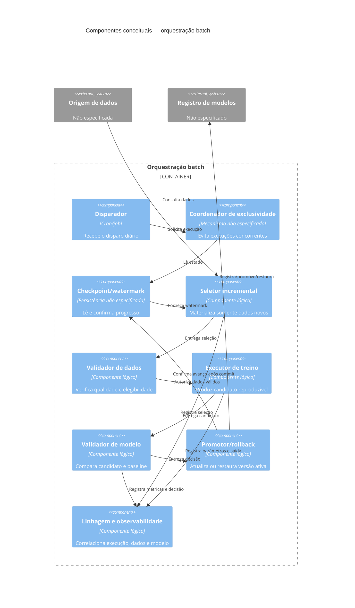
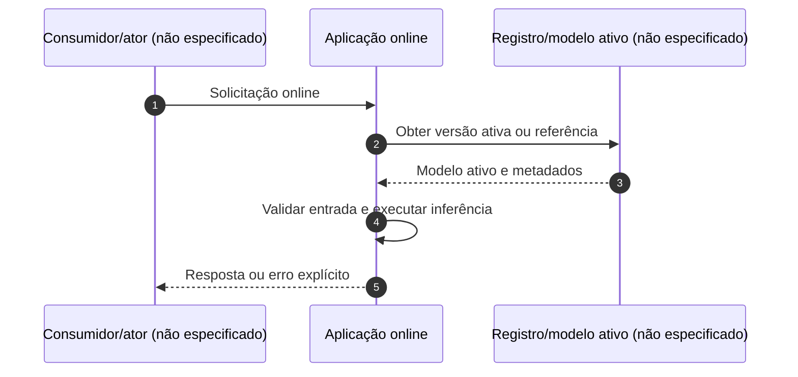
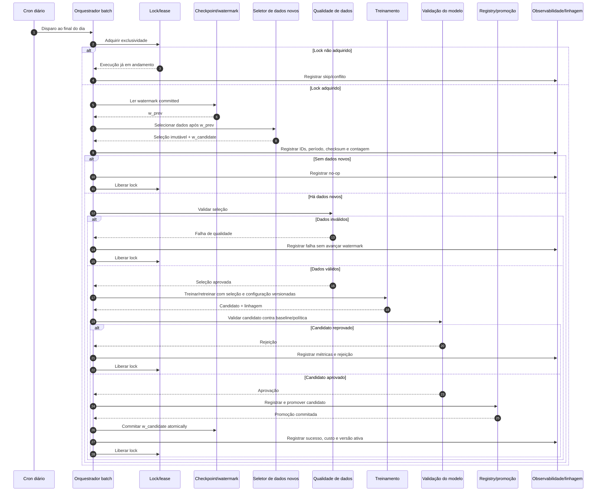

# Arquitetura — seção inicial

> **Status:** levantamento inicial, condicionado à disponibilidade dos artefatos de requisitos.
>
> Este documento distingue fatos observados, lacunas, conflitos, suposições e perguntas
> abertas. Nenhuma tecnologia, volume, SLA, usuário ou regra foi inferida como requisito.

## 1. Contexto e objetivo

### Fatos

- O repositório contém um projeto em `Site/`, descrito como gerado pelo Angular CLI
  22.1.7 em [Site/README.md](../Site/README.md). **Fonte:** `DOC-002`.
- O objetivo de negócio, o escopo funcional e o problema que o sistema deve resolver
  não estão descritos nos artefatos de produto localizados. **Fonte:** `DOC-001`,
  `DOC-002`, inventário documental desta análise.
- Existe um cron job executado diariamente ao final do dia para treinar ou retreinar,
  usando somente dados novos. **Fonte:** `USR-001` — restrição informada na
  solicitação atual.

### Objetivo arquitetural provisório

Organizar uma arquitetura que preserve a separação entre a aplicação existente e o
processo diário de treinamento/retreinamento, sem decidir componentes, fluxos,
volumes ou metas de operação que não estejam especificados. A arquitetura só poderá
ser detalhada após a confirmação do contexto de negócio e dos requisitos ausentes.

## 2. Stakeholders e personas

### Fatos

Nenhum stakeholder ou persona foi identificado nos artefatos de produto disponíveis.
`Site/README.md` documenta apenas comandos de desenvolvimento, build, testes e
servidor local; não atribui esses comandos a uma persona. **Fonte:** `DOC-002`.

### Lacuna

Faltam, no mínimo, os papéis envolvidos no uso da aplicação, na operação do job
diário, na disponibilização dos dados novos, na validação dos modelos e na
manutenção do sistema.

### Não assumido

Não foram criados nomes, perfis, permissões, responsabilidades ou jornadas de
usuário.

## 3. Requisitos arquiteturalmente significativos

### Confirmado

- **RA-001 — Treinamento incremental diário:** deve existir um cron job executado
  diariamente ao final do dia para treinar ou retreinar usando somente dados novos.
  **Origem:** `USR-001`.
- **RA-002 — Aplicação existente:** há um projeto no diretório `Site/`; o README o
  identifica como projeto Angular CLI 22.1.7. **Origem:** `DOC-002`.

### Lacunas

Não há especificação para:

- funcionalidades e fluxos de negócio;
- contratos de entrada e saída do job;
- definição de “dados novos”, janela de corte, idempotência ou deduplicação;
- comportamento quando não houver dados novos;
- tratamento de falha, repetição, concorrência ou recuperação do job;
- armazenamento de dados, modelos e versões;
- consumo, validação, aprovação e publicação de modelos;
- integração entre a aplicação e o processo de treinamento;
- autenticação, autorização, privacidade, auditoria e retenção;
- ambientes, implantação, observabilidade e operação.

## 4. Atributos de qualidade

### Fatos

Nenhum atributo de qualidade, métrica, limiar ou SLA foi definido nos documentos de
produto localizados. **Fonte:** `DOC-001`, `DOC-002`.

### Implicações a esclarecer

Os seguintes atributos são **pontos de investigação**, não requisitos confirmados:

- confiabilidade e recuperabilidade do job diário;
- consistência e rastreabilidade entre dados novos, execução e modelo produzido;
- segurança e controle de acesso aos dados e modelos;
- observabilidade da execução e dos resultados;
- manutenibilidade da aplicação e do pipeline de treinamento;
- desempenho e escalabilidade da aplicação e do processamento.

Não há base documental para ordenar esses atributos, atribuir pesos ou estabelecer
metas quantitativas.

## 5. Drivers arquiteturais priorizados

| Prioridade | Driver | Tipo | Origem | Consequência arquitetural provisória |
|---|---|---|---|---|
| 1 | Treinar ou retreinar diariamente apenas com dados novos | Restrição operacional | `USR-001` | O fluxo deve separar a seleção de dados novos da execução do treinamento e preservar a rastreabilidade dessa seleção. |
| 2 | Executar o treinamento ao final de cada dia | Restrição temporal | `USR-001` | O desenho deve comportar uma execução agendada diária; horário, fuso, tolerância e SLA permanecem indefinidos. |
| 3 | Preservar compatibilidade com a aplicação existente | Contexto técnico observado | `DOC-002` | Mudanças arquiteturais devem considerar o projeto localizado em `Site/`; não há autorização para substituir sua tecnologia. |

As prioridades acima ordenam apenas os drivers confirmados. Não representam
prioridades de negócio ou de qualidade ainda não documentadas.

## 6. Glossário

| Termo | Definição baseada nas fontes | Estado |
|---|---|---|
| Aplicação | Projeto localizado em `Site/`, descrito no README como gerado pelo Angular CLI 22.1.7. | Fato (`DOC-002`) |
| Cron job | Processo agendado que deve ser executado diariamente ao final do dia para treinar ou retreinar. | Fato da solicitação (`USR-001`) |
| Dados novos | Dados que devem ser usados pelo treinamento/retreinamento diário; a regra de identificação não foi definida. | Termo não definido (`USR-001`) |
| Treinamento | Processo mencionado pela restrição diária; objetivo, entradas, saídas e tecnologia não foram especificados. | Termo parcialmente definido (`USR-001`) |
| Retreinamento | Nova execução de treinamento mencionada pela restrição diária; critérios para escolher entre treinar e retreinar não foram definidos. | Termo parcialmente definido (`USR-001`) |

## 7. Riscos iniciais

| ID | Risco | Evidência | Impacto potencial | Mitigação dependente de decisão |
|---|---|---|---|---|
| R-001 | Dados novos podem ser selecionados de forma inconsistente entre execuções. | A restrição exige somente dados novos, mas não define a regra de novidade (`USR-001`). | Treinamento incompleto, duplicado ou não reproduzível. | Definir marcador de corte, identidade dos dados, deduplicação e idempotência. |
| R-002 | O job diário pode falhar sem um comportamento operacional definido. | Não há regras de retry, alerta, recuperação ou execução sem dados (`DOC-001`, `DOC-002`). | Ausência ou atraso de modelo atualizado. | Definir política de falha, reprocessamento, alertas e estado da execução. |
| R-003 | A arquitetura pode atender ao pipeline e não atender ao produto. | Não há contexto de negócio, personas ou requisitos funcionais (`DOC-001`, `DOC-002`). | Decisões prematuras e retrabalho. | Obter e versionar os artefatos de requisitos antes do detalhamento. |
| R-004 | Compatibilidade entre a aplicação e modelos/processos futuros pode não ser preservada. | A aplicação existente é identificada, mas suas interfaces e responsabilidades não (`DOC-002`). | Integração frágil ou necessidade de mudanças incompatíveis. | Definir contratos, ciclo de vida de modelos e pontos de integração. |

## 8. Separação de evidências

### Fatos

- `DOC-001`: [README.md](../README.md) existe, mas está vazio.
- `DOC-002`: [Site/README.md](../Site/README.md) identifica o projeto como Angular CLI
  22.1.7 e documenta comandos padrão do Angular CLI.
- `USR-001`: solicitação atual informa a existência do cron job diário ao final do
  dia, com treinamento/retreinamento usando somente dados novos.

### Lacunas

Não foram localizados artefatos de personas, requisitos funcionais, requisitos não
funcionais, regras de negócio, restrições adicionais ou decisões arquiteturais
anteriores do produto.

### Conflitos

Nenhum conflito entre os artefatos disponíveis foi identificado. A ausência de
requisitos não é tratada como autorização para escolher uma solução.

### Suposições controladas

- A aplicação em `Site/` é parte do sistema em análise, pois é o único artefato de
  produto identificável no repositório.
- O cron job é uma restrição obrigatória, não uma sugestão, porque foi explicitamente
  informado na solicitação.

Essas suposições devem ser confirmadas antes de decisões arquiteturais irreversíveis.

### Perguntas abertas

1. Qual problema de negócio e quais resultados o sistema deve produzir?
2. Quais são as personas, stakeholders, permissões e jornadas principais?
3. Quais são os requisitos funcionais e as regras de negócio identificadas por
   seus IDs?
4. Como “dados novos” são definidos, identificados, armazenados e protegidos?
5. Qual é o horário exato, fuso, tolerância e comportamento esperado do cron job?
6. O que diferencia treinar de retreinar e quais critérios escolhem cada operação?
7. O que deve ocorrer quando não houver dados novos ou quando o job falhar?
8. Onde ficam os dados, modelos, metadados, logs e históricos de execução?
9. Como um modelo é validado, aprovado, publicado, revertido e consumido?
10. Quais atributos de qualidade têm prioridade e quais métricas/limiares devem ser
    atendidos?
11. Quais restrições legais, de segurança, infraestrutura, custo ou implantação se
    aplicam?
12. Quais decisões anteriores devem ser preservadas e quais interfaces da aplicação
    já são contratos?

## 9. Responsabilidades e limites

Esta seção é um desenho conceitual. Os nomes abaixo representam responsabilidades,
não tecnologias ou componentes já escolhidos.

| Responsabilidade | Faz | Não faz | Base |
|---|---|---|---|
| Aplicação online | Recebe requisições dos consumidores ainda não identificados e consulta/usa o modelo publicado por uma interface estável. | Não treina, não altera o checkpoint e não promove modelos. | RA-002; separação online/batch é decisão arquitetural sem requisito explícito. |
| Ingestão/registro de dados | Disponibiliza dados e seus identificadores/metadados para o processamento batch. | Não decide sozinha que um dado é elegível sem a política de novidade. | RA-001; detalhes são lacuna. |
| Orquestração batch | Inicia uma execução diária, adquire exclusividade, coordena seleção, qualidade, treinamento, validação e publicação do resultado. | Não deve publicar modelo que falhe nos critérios de validação definidos. | RA-001; proteção de integridade é decisão sem limiar documentado. |
| Seleção incremental | Determina o conjunto de dados novos a partir do checkpoint/watermark e produz uma seleção auditável. | Não deve avançar o checkpoint antes da conclusão definida para a execução. | RA-001; política exata é lacuna. |
| Treinamento/retreinamento | Gera candidato usando somente a seleção da execução e parâmetros versionados. | Não deve ler implicitamente dados fora da seleção registrada. | RA-001; reprodutibilidade é atributo a esclarecer. |
| Validação e promoção | Compara o candidato com critérios de qualidade e decide, conforme política aprovada, se ele pode ser registrado/publicado. | Não substitui o modelo ativo sem evidência de validação. | R-004; critérios e aprovador não foram definidos. |
| Registro de modelos | Mantém versões, artefatos, metadados, métricas e estado de promoção. | Não define os critérios de negócio ou de qualidade. | Necessidade derivada de rastreabilidade; decisão sem requisito explícito. |
| Operação/observabilidade | Acompanha execução, falhas, métricas, alertas, custos e trilha de auditoria. | Não deve mascarar falhas nem converter execução inconclusa em sucesso. | Atributos de qualidade a esclarecer; decisão sem SLA. |

### Limites de sistema

- **Dentro do sistema:** aplicação em `Site/`, coordenação do job diário, seleção de
  dados novos, treinamento/retreinamento, validação, versionamento e publicação de
  modelos — os três últimos ainda dependem de confirmação do escopo.
- **Fora do sistema:** origem dos dados, consumidores online, identidade dos atores,
  infraestrutura de agendamento e serviços de armazenamento não foram identificados.
- **Não decidido:** se a aplicação executa inferência localmente, chama um serviço
  de modelo, ou usa outra integração; se dados e modelos compartilham armazenamento;
  e se o job é um processo interno ou uma plataforma externa.

## 10. Interfaces conceituais

As interfaces seguintes são contratos a especificar; não são APIs existentes.

| Interface | Direção | Conteúdo mínimo a definir | Invariantes propostos | Estado |
|---|---|---|---|---|
| `OnlineRequest` / `OnlineResponse` | Consumidor ↔ aplicação | Identidade da requisição, entrada, resposta, versão do modelo e erro | Não expor dados ou artefatos além da autorização; versão usada deve ser rastreável | Decisão sem requisito |
| `NewDataSelection` | ingestão ↔ batch | Identificador da fonte, período/corte, IDs selecionados, checksum/contagem e watermark anterior | Seleção imutável por execução; nenhum dado fora dela entra no treino | Derivada de RA-001 |
| `TrainingRun` | orquestração ↔ treinamento | ID da execução, seleção, código, configuração, ambiente e saída | Reexecução com o mesmo identificador não cria efeitos duplicados | Decisão sem requisito |
| `ValidationResult` | treinamento ↔ validação/promoção | Métricas, conjunto de avaliação, comparação com baseline e decisão | Promoção exige resultado completo e critérios versionados | R-004; limiares ausentes |
| `ModelArtifact` | treinamento/registro ↔ aplicação | Artefato, versão, assinatura/checksum, metadados e estado | Aplicação usa somente versão registrada como ativa | Decisão sem requisito |
| `Checkpoint` | seleção ↔ controle de execução | Watermark, versão do esquema/política e estado committed | Avanço atômico apenas após o ponto de commit definido | RA-001; política de commit é lacuna |
| `RunEvent` | todos os componentes ↔ observabilidade | IDs correlacionados, estado, timestamps, métricas, erro e custo | Eventos não devem conter dados pessoais sem justificativa e proteção | Segurança/LGPD é lacuna |

### Alternativas de integração

1. **Serviço de inferência separado:** favorece isolamento e troca de modelo, mas
   adiciona uma interface operacional e um ponto de falha.
2. **Inferência dentro da aplicação:** reduz hops e operação, mas acopla ciclo de
   vida do modelo ao deploy da aplicação.
3. **Artefato compartilhado por armazenamento:** simples conceitualmente, porém
   exige controle de concorrência, integridade e permissões.

Não há requisito para escolher entre as alternativas. A escolha depende de
latência, volume, segurança, frequência de publicação e responsabilidades operacionais
que ainda não foram documentados.

## 11. Visões C4 conceituais

Os diagramas mostram somente relações confirmadas ou explicitamente marcadas como
não especificadas. `System_Boundary` e `Container_Boundary` são limites lógicos,
não compromissos de implantação.

### 11.1 Contexto



### 11.2 Contêineres lógicos



### 11.3 Componentes do batch



## 12. Sequências

### 12.1 Fluxo online



Esse fluxo é apenas uma separação de responsabilidades. Não há requisito que
defina inferência, latência, formato de entrada/saída ou comportamento do modelo
ativo; todos permanecem perguntas abertas.

### 12.2 Fluxo batch diário incremental



O ponto de commit mostrado é uma proposta: se o registro do modelo e o avanço do
watermark não puderem ser atômicos, a recuperação deve usar um estado de execução
durável e operações idempotentes para evitar perda ou duplicação silenciosa.

## 13. Análise de operação e ML

### 13.1 Watermark/checkpoint

**Decisão proposta D-001 (sem requisito completo):** manter um checkpoint durável por
fonte/partição, com `w_prev`, `w_candidate`, identificador da execução e estado
(`started`, `validated`, `published`, `committed`, `failed`). A seleção deve ser
materializada antes do treinamento.

- **Justificativa:** RA-001 exige somente dados novos; R-001 exige evitar
  inconsistência e preservar rastreabilidade.
- **Alternativa:** usar apenas timestamp de leitura. É mais simples, mas perde
  eventos fora de ordem e torna reprocessamento ambíguo.
- **Pergunta:** o dado possui offset monotônico, timestamp confiável ou identificador
  de versão? A janela de atraso permitida não foi definida.

### 13.2 Idempotência, lock e concorrência

**Decisão proposta D-002 (sem requisito explícito):** gerar uma chave idempotente por
fonte + intervalo/offset + política de seleção; adquirir lock com expiração
controlada; rejeitar ou registrar uma segunda execução enquanto a primeira estiver
ativa. O lock não deve ser a única fonte de verdade do estado.

- **Justificativa:** o cron é diário e não há regra de concorrência; duplicidade
  pode quebrar RA-001.
- **Alternativas:** lock exclusivo simples (menor complexidade, recuperação mais
  arriscada) ou lease renovável (melhor para falhas, requer relógio/timeout
  definidos).
- **Perguntas:** pode haver execução manual? Há múltiplas fontes/partições? Qual
  autoridade cancela ou recupera um lock expirado?

### 13.3 Retry e recuperação

**Decisão proposta D-003 (sem SLA):** separar falhas transitórias de falhas de
  dados/modelo; permitir retry limitado e idempotente para as primeiras; manter
  checkpoint anterior em falha; permitir retomada por estado da execução ou
  reprocessamento explícito.

- **Justificativa:** R-002 identifica ausência de política de falha e recuperação.
- **Alternativa:** retry ilimitado, rejeitada provisoriamente por poder sobrepor o
  próximo ciclo e elevar custos.
- **Perguntas:** número máximo de tentativas, backoff, janela de recuperação, alerta
  e responsável operacional não foram definidos.

### 13.4 Qualidade de dados e linhagem

**Decisão proposta D-004 (sem critérios):** bloquear treinamento quando validações
obrigatórias falharem; registrar esquema, contagem, período, IDs/partições,
checksum, perfil de qualidade, transformação, código e configuração.

- **Justificativa:** RA-001 limita os dados; R-001 e R-004 exigem rastreabilidade
  para explicar o modelo produzido.
- **Alternativa:** permitir treino com dados incompletos e somente alertar. É mais
  disponível, mas não garante que “somente dados novos” sejam dados válidos.
- **Perguntas:** quais regras de completude, duplicidade, distribuição, privacidade
  e representatividade são obrigatórias?

### 13.5 Reprodutibilidade

**Decisão proposta D-005 (atributo não confirmado):** registrar versão do código,
configuração, dependências, ambiente, seleção, sementes quando aplicável, métricas e
checksums dos artefatos.

- **Justificativa:** R-001 e R-004 tornam necessário explicar a origem do candidato
  e repetir uma execução.
- **Alternativa:** guardar apenas o modelo final. Reduz custo inicial, mas impede
  auditoria e recuperação confiável.
- **Pergunta:** qual nível de reprodução é exigido: bit a bit, mesma métrica ou apenas
  rastreabilidade operacional?

### 13.6 Validação, registry, promoção e rollback

**Decisão proposta D-006 (sem limiares de requisito):** validar o candidato contra
um baseline vigente e uma política versionada; registrar candidato antes da
promoção; promover de forma reversível; manter a versão anterior para rollback.

- **Justificativa:** R-004 exige compatibilidade com modelos/processos futuros e o
  risco R-004 aponta a necessidade de ciclo de vida; os limiares ainda são lacuna.
- **Alternativas:** promoção automática (menor intervenção, maior risco) ou promoção
  manual (maior controle, maior atraso). Nenhuma pode ser escolhida sem
  stakeholder e critérios.
- **Perguntas:** quais métricas, conjuntos de avaliação, aprovação humana,
  compatibilidade, período de observação e gatilhos de rollback se aplicam?

### 13.7 Observabilidade

**Decisão proposta D-007 (atributo não confirmado):** correlacionar cron, execução,
seleção, treino, validação, modelo e checkpoint; emitir estados explícitos de
sucesso, no-op, retry, falha, rejeição e rollback; não registrar dados pessoais
brutos por padrão.

- **Justificativa:** R-002 requer tornar falhas recuperáveis; rastreabilidade é uma
  implicação identificada na seção 4.
- **Alternativa:** logs livres sem correlação. É mais simples, mas dificulta auditoria
  e diagnóstico.
- **Perguntas:** quais métricas, retenção, alertas, dashboards e responsáveis são
  necessários?

### 13.8 Segurança, LGPD e acesso

**Fato:** nenhuma política de segurança, classificação de dados, base legal,
retenção ou requisito LGPD foi localizada.

**Salvaguardas propostas D-008 (sem requisito confirmado):**

- minimizar dados pessoais na seleção e nos logs;
- separar permissões de leitura de dados, execução, promoção e rollback;
- proteger dados, checkpoints, modelos e métricas em trânsito e repouso;
- manter trilha de auditoria de acessos e decisões;
- definir retenção e eliminação conforme finalidade e orientação jurídica;
- tratar datasets, features, modelos e logs como ativos com classificação definida.

Essas salvaguardas não determinam uma tecnologia nem substituem a definição do
controlador, operador, finalidade, base legal, titulares, direitos ou prazos.

### 13.9 Custos

**Decisão proposta D-009 (sem volumes/custos documentados):** medir custo por
execução, armazenamento de seleções/artefatos, retries e tempo de recursos; evitar
reprocessar dados já committed; aplicar retenção somente após definição de auditoria
e LGPD.

- **Justificativa:** o processamento é diário e pode acumular artefatos; o custo é
  uma consequência operacional a controlar, não um requisito quantificado.
- **Alternativas:** reter tudo (melhor auditoria, maior custo), reter apenas ativos
  (menor custo, pior investigação) ou política híbrida. A escolha depende de
  requisitos de retenção e auditoria ausentes.
- **Perguntas:** há orçamento, limite de duração, limite de armazenamento,
  sazonalidade, necessidade de reprocessamento histórico ou restrição de
  infraestrutura?

## 14. Decisões e pendências

| ID | Decisão/pendência | Classificação | Origem ou justificativa | Requer confirmação de |
|---|---|---|---|---|
| D-001 | Checkpoint durável e seleção materializada | Proposta arquitetural | RA-001, R-001 | Dono dos dados/operação |
| D-002 | Idempotência por execução e lock/lease | Proposta arquitetural | Cron diário; risco de concorrência | Operação |
| D-003 | Retry limitado e sem avanço de checkpoint em falha | Proposta arquitetural | R-002 | Operação |
| D-004 | Bloqueio por falha de qualidade e linhagem completa | Proposta arquitetural | RA-001, R-001, R-004 | Dono do produto/dados |
| D-005 | Registro de insumos para reprodução | Decisão sem requisito confirmado | R-001, R-004 | Auditoria/dados |
| D-006 | Registry, baseline, promoção reversível e rollback | Proposta arquitetural | R-004 | Dono do modelo/operação |
| D-007 | Observabilidade correlacionada e estados explícitos | Decisão sem requisito confirmado | R-002 e atributos a esclarecer | Operação |
| D-008 | Salvaguardas LGPD e segregação de acesso | Decisão sem requisito confirmado | Ausência de política; risco potencial | Jurídico/segurança |
| D-009 | Medição e retenção orientadas a custo | Decisão sem requisito confirmado | Execução diária; volumes ausentes | Finanças/operação |

Até que as confirmações sejam obtidas, as propostas desta seção devem ser tratadas
como alternativas de arquitetura e não como requisitos ou decisões irrevogáveis.

## 15. Avaliação ATAM independente

### 15.1 Escopo e método

Esta avaliação aplica ATAM aos drivers e às abordagens registradas neste documento.
Não há personas confirmadas, requisitos funcionais completos, atributos de qualidade
quantificados ou SLAs. Portanto, a classificação de importância e dificuldade é uma
priorização analítica provisória, e todas as métricas abaixo são **hipóteses
pendentes**, não metas ou fatos.

Abordagens avaliadas:

- **A1 — checkpoint + seleção materializada:** D-001.
- **A2 — idempotência + lock/lease:** D-002.
- **A3 — retry limitado + recuperação por estado:** D-003.
- **A4 — bloqueio por qualidade + linhagem:** D-004.
- **A5 — reprodução por insumos versionados:** D-005.
- **A6 — validação, registry, promoção reversível e rollback:** D-006.
- **A7 — observabilidade correlacionada:** D-007.
- **A8 — segregação, minimização e proteção de dados:** D-008.
- **A9 — medição de custo e retenção condicionada:** D-009.

### 15.2 Utility tree

```text
Utilidade do sistema
├── Confiabilidade do batch diário [RA-001, R-002]
│   ├── Execução diária concluída ou explicitamente encerrada [S-01 | I alta, D média]
│   ├── Falha parcial recuperável sem perda/duplicação silenciosa [S-03 | I alta, D alta]
│   └── Jobs sobrepostos não produzem commits concorrentes [S-04 | I alta, D média]
├── Integridade incremental e dados [RA-001, R-001]
│   ├── Somente dados novos são selecionados [S-02 | I alta, D alta]
│   └── Degradação de dados bloqueia ou sinaliza decisão explícita [S-05 | I alta, D alta]
├── Qualidade e governança do modelo [R-004, atributos a esclarecer]
│   ├── Candidato pior não é promovido [S-06 | I alta, D alta]
│   └── Rollback restaura versão conhecida [S-07 | I alta, D média]
├── Disponibilidade e continuidade [R-002, atributos a esclarecer]
│   └── Indisponibilidade não publica estado falso [S-08 | I média, D alta]
└── Segurança e privacidade [lacuna explícita, D-008]
    └── Vazamento de dados pessoais é evitado/detectado [S-09 | I alta, D alta]
```

`I` significa importância relativa para a utilidade; `D` significa dificuldade
relativa de realizar e validar a abordagem. Ambos são julgamentos provisórios, pois
não há stakeholders ou prioridades de negócio documentados.

### 15.3 Cenários priorizados

Formato obrigatório: **fonte; estímulo; ambiente; artefato; resposta; métrica**.
Os valores de métrica são hipóteses a confirmar; onde não há base para propor valor,
o cenário registra “a definir”.

#### S-01 — Execução diária

- **Prioridade:** I alta, D média.
- **Fonte:** cron job diário (`USR-001`).
- **Estímulo:** chega o disparo ao final do dia.
- **Ambiente:** operação normal, sem execução concorrente conhecida.
- **Artefato:** orquestrador batch, checkpoint, seleção incremental e observabilidade.
- **Resposta:** iniciar uma execução identificada; selecionar dados novos; concluir
  com sucesso, no-op, rejeição ou falha explícita; somente uma execução aprovada
  pode avançar o checkpoint.
- **Métrica (hipótese):** propor taxa de execuções com estado terminal explícito e
  ausência de avanço indevido; horário-limite e percentual aceitável ainda estão
  a definir.
- **Abordagens:** A1, A3, A7.
- **Vínculos:** RA-001, D-001, D-003, D-007, R-002.

#### S-02 — Dados novos

- **Prioridade:** I alta, D alta.
- **Fonte:** origem de dados não identificada.
- **Estímulo:** existem registros posteriores ao checkpoint anterior, inclusive
  registros potencialmente atrasados ou duplicados.
- **Ambiente:** execução batch elegível.
- **Artefato:** seletor incremental, checkpoint e seleção materializada.
- **Resposta:** produzir uma seleção auditável segundo a definição aprovada de
  novidade; excluir registros já committed; preservar candidatos fora da janela
  para política posterior, sem incorporá-los silenciosamente.
- **Métrica (hipótese):** propor contagem de IDs selecionados, excluídos e
  duplicados reconciliada com a fonte; tolerância e janela de atraso estão a definir.
- **Abordagens:** A1, A4, A5.
- **Vínculos:** RA-001, D-001, D-004, D-005, R-001.

#### S-03 — Falha parcial

- **Prioridade:** I alta, D alta.
- **Fonte:** serviço de dados, treinamento, registry ou observabilidade falha no
  meio da execução.
- **Estímulo:** uma etapa termina parcialmente e o processo é interrompido.
- **Ambiente:** execução com seleção registrada e checkpoint anterior committed.
- **Artefato:** estado da execução, lock, artefatos temporários e checkpoint.
- **Resposta:** marcar falha; não avançar o checkpoint sem commit definido; liberar ou
  recuperar exclusividade; permitir retry/retomada idempotente sem publicar sucesso
  falso.
- **Métrica (hipótese):** propor zero commits incompletos e reconciliação de cada
  execução interrompida; limite de recuperação e número de retries estão a definir.
- **Abordagens:** A2, A3, A5, A7.
- **Vínculos:** R-002, D-002, D-003, D-005, D-007.

#### S-04 — Jobs sobrepostos

- **Prioridade:** I alta, D média.
- **Fonte:** cron, operador ou mecanismo de retry dispara duas execuções.
- **Estímulo:** segunda execução tenta processar a mesma fonte/partição enquanto a
  primeira mantém estado ativo.
- **Ambiente:** concorrência real ou lock expirado.
- **Artefato:** lock/lease, chave idempotente, checkpoint e registry.
- **Resposta:** uma execução obtém exclusividade; a outra é rejeitada ou registrada
  como skip; não há promoção ou avanço de checkpoint concorrente.
- **Métrica (hipótese):** propor no máximo um commit por chave de seleção e zero
  promoções concorrentes; timeout/lease ainda estão a definir.
- **Abordagens:** A2, A7.
- **Vínculos:** D-002, D-007, R-001, R-002.

#### S-05 — Degradação dos dados

- **Prioridade:** I alta, D alta.
- **Fonte:** validação de dados.
- **Estímulo:** seleção contém qualidade inferior à política, esquema incompatível,
  duplicidade ou distribuição alterada.
- **Ambiente:** antes do treinamento, com seleção materializada.
- **Artefato:** validador de dados, execução, linhagem e checkpoint.
- **Resposta:** bloquear ou encaminhar para decisão explícita; registrar evidências;
  não incorporar dados degradados como se fossem válidos e não avançar o checkpoint
  de forma silenciosa.
- **Métrica (hipótese):** propor cobertura das regras de qualidade e proporção de
  seleções com decisão registrada; regras, limiares e tolerâncias estão a definir.
- **Abordagens:** A4, A7, A9.
- **Vínculos:** D-004, D-007, D-009, R-001, R-002.

#### S-06 — Candidato pior

- **Prioridade:** I alta, D alta.
- **Fonte:** validador de modelo.
- **Estímulo:** candidato apresenta métricas ou compatibilidade piores que o
  baseline, conforme política ainda não definida.
- **Ambiente:** candidato treinado com dados considerados elegíveis.
- **Artefato:** validação, registry, promoção e modelo ativo.
- **Resposta:** rejeitar promoção; registrar candidato e métricas; manter modelo
  ativo; deixar o checkpoint conforme a política aprovada, sem mascarar a rejeição.
- **Métrica (hipótese):** propor zero promoções de candidatos que não atendam aos
  critérios versionados; métricas, baseline e limiares estão a definir.
- **Abordagens:** A5, A6, A7.
- **Vínculos:** D-005, D-006, D-007, R-004.

#### S-07 — Rollback

- **Prioridade:** I alta, D média.
- **Fonte:** operador, regra de detecção ou incidente de modelo ainda não definido.
- **Estímulo:** versão ativa precisa ser retirada após promoção.
- **Ambiente:** modelo anterior registrado e elegível para restauração.
- **Artefato:** registry, aplicação online e observabilidade.
- **Resposta:** apontar para uma versão anterior conhecida; registrar motivo, ator,
  tempo e versão; impedir que o batch em andamento substitua o rollback sem uma
  nova decisão válida.
- **Métrica (hipótese):** propor rastreabilidade completa da troca e consistência
  da versão ativa após rollback; tempo-alvo e critério de sucesso estão a definir.
- **Abordagens:** A6, A7, A8.
- **Vínculos:** D-006, D-007, D-008, R-004.

#### S-08 — Indisponibilidade

- **Prioridade:** I média, D alta.
- **Fonte:** origem de dados, registry, aplicação ou infraestrutura fica indisponível.
- **Estímulo:** uma dependência necessária não responde durante o ciclo online ou
  batch.
- **Ambiente:** falha transitória ou prolongada; SLA não especificado.
- **Artefato:** aplicação online ou etapa batch dependente.
- **Resposta:** online deve retornar erro explícito ou comportamento degradado
  aprovado; batch deve registrar falha/no-op, conservar estado consistente e usar
  retry/recuperação sem duplicação; não deve declarar sucesso sem evidência.
- **Métrica (hipótese):** propor disponibilidade, tempo de detecção, tempo de
  recuperação e percentual de execuções recuperadas; todos os valores estão a definir.
- **Abordagens:** A3, A6, A7, A9.
- **Vínculos:** R-002, D-003, D-006, D-007, D-009.

#### S-09 — Vazamento

- **Prioridade:** I alta, D alta.
- **Fonte:** ator não autorizado, log, artefato, modelo ou integração.
- **Estímulo:** tentativa de acesso ou exposição acidental de dados pessoais ou
  atributos sensíveis.
- **Ambiente:** online, batch, observabilidade ou armazenamento.
- **Artefato:** dados, seleções, logs, checkpoints, modelos e interfaces.
- **Resposta:** negar acesso; minimizar e proteger dados; registrar evento sem
  replicar o conteúdo sensível; acionar tratamento de incidente e preservar
  evidências conforme política aprovada.
- **Métrica (hipótese):** propor zero acessos não autorizados confirmados, cobertura
  de controles e tempo de detecção; classificação, base legal e metas estão a definir.
- **Abordagens:** A4, A7, A8, A9.
- **Vínculos:** D-004, D-007, D-008, D-009; lacuna de segurança/LGPD.

## 16. Pontos de sensibilidade

Um ponto é sensível quando uma decisão altera diretamente um atributo prioritário ou
o resultado de vários cenários.

| ID | Decisão sensível | Cenários | Atributos afetados | Análise |
|---|---|---|---|---|
| PS-01 | Definição de novidade e semântica do watermark | S-01, S-02, S-03, S-04, S-05 | Integridade, recuperabilidade, rastreabilidade | Uma política de timestamp, offset ou ID muda quais dados entram e se reprocessamento é seguro. |
| PS-02 | Ponto de commit entre modelo promovido e checkpoint | S-03, S-06, S-07 | Consistência, disponibilidade, rollback | Commit não atômico pode causar modelo publicado sem avanço correspondente, ou avanço sem modelo utilizável. |
| PS-03 | Semântica de lock/lease e execução manual | S-03, S-04 | Confiabilidade, recuperação | Lease curto pode duplicar execução; lease longo pode bloquear recuperação. |
| PS-04 | Política de promoção e critérios do baseline | S-06, S-07, S-08 | Qualidade, continuidade | Critérios permissivos favorecem atualização; critérios rígidos preservam estabilidade e podem atrasar atualização. |
| PS-05 | Granularidade da linhagem e retenção | S-02, S-03, S-05, S-09 | Auditoria, custo, LGPD | Mais evidência melhora diagnóstico, mas aumenta armazenamento e exposição potencial. |
| PS-06 | Localização da inferência | S-07, S-08, S-09 | Disponibilidade, segurança, compatibilidade | Serviço separado isola ciclos; inferência embutida reduz dependências, mas acopla deploy e modelo. |

Nenhum ponto de sensibilidade é uma decisão aprovada; todos dependem de requisitos,
stakeholders ou políticas ausentes.

## 17. Trade-offs

| ID | Escolha | Benefício | Custo/risco | Cenários |
|---|---|---|---|---|
| T-01 | Seleção materializada versus consulta no treino | Repetibilidade, auditoria e isolamento da seleção | Armazenamento e processamento adicionais | S-02, S-03, S-05 |
| T-02 | Lock/lease versus paralelismo | Evita commits conflitantes | Pode reduzir disponibilidade ou exigir recuperação de lease | S-03, S-04 |
| T-03 | Bloquear dados degradados versus continuar com alerta | Protege qualidade e linhagem | Pode atrasar atualização e exigir intervenção | S-05, S-08 |
| T-04 | Promoção automática versus manual | Automática reduz espera; manual aumenta controle | Automática pode promover regressão; manual adiciona atraso e operação | S-06, S-07 |
| T-05 | Reter evidências amplas versus mínimas | Auditoria/reprodução versus menor custo e exposição | Retenção ampla custa mais e pode aumentar superfície LGPD | S-02, S-03, S-09 |
| T-06 | Registry/rollback formal versus artefato simples | Reversibilidade e governança versus menor complexidade inicial | Registry exige contratos e operação | S-06, S-07, S-08 |

## 18. Riscos, não-riscos e temas de risco

### Riscos confirmados ou derivados

| ID | Risco | Cenários | Decisões relacionadas | Tratamento |
|---|---|---|---|---|
| ATAM-R-01 | Watermark incorreto inclui dados antigos ou perde dados atrasados. | S-02, S-03, S-05 | D-001, D-004, D-005 | Definir semântica de novidade, partição, atraso e reprocessamento antes de fechar a solução. |
| ATAM-R-02 | Falha entre promoção e checkpoint deixa estado inconsistente. | S-03, S-06, S-07 | D-001, D-003, D-006 | Definir protocolo de commit/compensação e reconciliação. |
| ATAM-R-03 | Lock expirado permite duas execuções ou lock preso impede recuperação. | S-03, S-04 | D-002, D-003 | Definir lease, renovação, autoridade de recuperação e testes de concorrência. |
| ATAM-R-04 | Dados degradados treinam modelo sem decisão explícita. | S-05, S-06 | D-004, D-006 | Definir regras, limiares e política de bloqueio/aceitação. |
| ATAM-R-05 | Candidato pior substitui baseline. | S-06, S-07 | D-005, D-006 | Exigir validação versionada, registro anterior e promoção reversível. |
| ATAM-R-06 | Indisponibilidade é reportada como sucesso ou causa perda de estado. | S-01, S-03, S-08 | D-003, D-007 | Estados terminais explícitos, retries idempotentes e reconciliação. |
| ATAM-R-07 | Dados pessoais aparecem em logs, seleções, artefatos ou modelo. | S-02, S-05, S-09 | D-004, D-007, D-008, D-009 | Classificar dados, minimizar, segregar acesso, proteger e definir retenção com orientação jurídica. |

### Não-riscos no estado atual

Estes itens não são riscos arquiteturais confirmados porque não há evidência
documental suficiente para afirmar que ocorram:

- um volume específico de dados ou uma taxa específica de requisições;
- um SLA, latência, janela de execução ou custo máximo;
- uma tecnologia de armazenamento, orquestração, registry ou observabilidade;
- uma persona, permissão ou jornada de usuário concreta;
- uma exigência de alta disponibilidade, multi-região ou escalabilidade horizontal;
- uma regra de negócio sobre aceitação de modelo ou qualidade preditiva.

Isso não significa que sejam irrelevantes; significa apenas que não devem ser
tratados como fatos, riscos quantificados ou critérios de aprovação sem requisitos.

### Temas de risco para elicitação

1. **Semântica de dados novos:** fonte de verdade, offsets, atrasos, duplicidade e
   correções retroativas.
2. **Operação do cron:** fuso, horário, janela, execução manual, alertas, ownership,
   retries e recuperação.
3. **Governança de modelos:** baseline, métricas, aprovação, compatibilidade,
   promoção, observação e rollback.
4. **Segurança e LGPD:** classificação, finalidade, base legal, titulares, acesso,
   retenção, eliminação e resposta a incidentes.
5. **Continuidade:** comportamento online durante indisponibilidade, modelo ativo
   anterior e política de degradação.
6. **Economia:** limites de processamento, armazenamento, retenção e reprocessamento.
7. **Escopo do produto:** personas, jornadas, funcionalidades e contratos da
   aplicação em `Site/`.

## 19. Conclusão ATAM e decisões pendentes

Os maiores focos de atenção são a semântica de “dados novos” (PS-01), o commit
coerente entre publicação e checkpoint (PS-02), a concorrência do cron (PS-03), os
critérios de promoção (PS-04) e a fronteira entre linhagem, custo e LGPD (PS-05).
Eles concentram os cenários de maior importância e dificuldade: S-02, S-03, S-05,
S-06 e S-09.

Não há base para declarar a arquitetura aprovada: faltam personas, requisitos de
negócio, critérios de qualidade, métricas, políticas de dados/modelos e
responsáveis. Antes de transformar A1–A9 em decisões, devem ser confirmados os
temas de risco e os valores das métricas hipotéticas. A avaliação não altera
`DOC-001`, `DOC-002`, `USR-001`, RA-001, RA-002 nem os riscos anteriores; apenas
adiciona análise independente e rastreável.

## 20. Painel revisor independente

O painel abaixo revisa a arquitetura sem promover lacunas a requisitos. As objeções
representam divergências entre perspectivas; não são decisões aprovadas.

### 20.1 Arquiteto de solução

- **Objeção:** os diagramas C4 apresentam ingestão, registry e observabilidade como
  contêineres internos, mas a seção de limites declara que suas tecnologias,
  implantação e até o escopo de validação/publicação não estão confirmados.
- **Fundamento:** RA-002 só confirma uma aplicação em `Site/`; RA-001 confirma o
  cron diário. A fronteira apresentada é útil como modelo lógico, mas pode induzir
  uma decomposição física não autorizada.
- **Divergência:** manter o C4 lógico favorece discussão de responsabilidades; reduzir
  o C4 a aplicação + job seria mais fiel à evidência, porém perderia os pontos de
  controle necessários para avaliar o batch.
- **Condição:** manter a legenda “conceitual” e validar a fronteira quando contratos
  e ownership forem definidos.

### 20.2 Dados/ML

- **Objeção:** “somente dados novos” não garante um treino incremental correto se não
  houver semântica de evento atrasado, correção retroativa, deduplicação e política
  de dados de referência.
- **Fundamento:** R-001 e PS-01 identificam a ambiguidade do watermark; S-02 exige
  distinguir registros novos, atrasados e duplicados.
- **Divergência:** checkpoint por offset/partição é mais seguro contra perda quando a
  fonte oferece offset monotônico; timestamp é mais portável, mas pode perder ou
  repetir dados. Não há evidência para escolher.
- **Condição:** executar experimento com dados representativos e confirmar a fonte de
  verdade antes de fechar D-001.

### 20.3 Segurança/LGPD

- **Objeção:** D-008 é apenas uma salvaguarda proposta; não há classificação,
  finalidade, base legal, controlador, retenção ou matriz de acesso. “Não registrar
  dados pessoais brutos” não elimina vazamento por features, artefatos ou modelo.
- **Fundamento:** a própria seção 13.8 registra ausência de política; S-09 e ATAM-R-07
  tratam o risco sem métrica confirmada.
- **Divergência:** mascarar dados em logs pode preservar diagnóstico, mas pode
  destruir evidência de incidente; retenção ampla ajuda auditoria, mas aumenta
  exposição e custo.
- **Condição:** obter avaliação jurídica e classificação de dados antes de promoção
  para produção.

### 20.4 Operações/SRE

- **Objeção:** retry limitado, lease e estados explícitos não constituem uma política
  operacional sem owner, janela, alertas, runbook e tratamento de dependências
  indisponíveis.
- **Fundamento:** R-002, S-03, S-04 e S-08 deixam retry, timeout, recuperação e
  disponibilidade como perguntas abertas.
- **Divergência:** no-op quando não há dados reduz custo e ruído; pode ocultar atraso
  de ingestão se não houver métrica de frescor. Retry automático melhora recuperação;
  pode sobrepor o próximo ciclo e elevar custo.
- **Condição:** teste de falhas e definição de estados terminais antes de declarar
  confiabilidade operacional.

### 20.5 Custos

- **Objeção:** seleção materializada, linhagem completa, registry e retenção ampla
  têm custo potencial, mas não há volume, orçamento, frequência de reprocessamento
  ou política de retenção para comparar alternativas.
- **Fundamento:** D-009, PS-05, T-01 e T-05 explicitam o trade-off sem valores.
- **Divergência:** guardar toda a seleção favorece reprodutibilidade; guardar apenas
  referência/checksum reduz custo, mas pode impedir auditoria se a fonte mudar.
- **Condição:** medir custo de uma execução representativa e definir retenção com
  jurídico, operação e dados.

### 20.6 Facilitador ATAM

- **Objeção:** a utility tree prioriza confiabilidade, integridade e segurança por
  julgamento arquitetural, não por priorização de stakeholders.
- **Fundamento:** não há personas, requisitos funcionais, atributos quantificados ou
  SLAs documentados.
- **Divergência:** a priorização é necessária para revelar pontos de sensibilidade,
  mas deve ser tratada como hipótese até validação.
- **Condição:** revisar importância/dificuldade com stakeholders identificados e
  registrar a origem de cada prioridade.

## 21. Verificação de coerência

| Relação verificada | Resultado | Observação |
|---|---|---|
| C4 ↔ sequência batch | Parcialmente coerente | Os participantes da sequência correspondem aos contêineres/componentes lógicos; lock, watermark e qualidade aparecem detalhados na sequência e não como contêineres separados, corretamente tratados como responsabilidades internas. |
| C4 ↔ sequência online | Coerente com ressalva | A aplicação usa um modelo ativo, mas a existência do fluxo de inferência e seu contrato ainda não é requisito confirmado. |
| Pipeline ↔ utility tree | Coerente | Seleção/checkpoint cobrem S-01/S-02; lock/retry cobrem S-03/S-04; qualidade/validação cobrem S-05/S-06; registry/rollback cobrem S-07; observabilidade cobre S-08; D-008 cobre S-09. |
| Utility tree ↔ riscos | Coerente | Os cenários prioritários estão vinculados a R-001–R-004 e ATAM-R-01–ATAM-R-07. |
| Sequência ↔ commit | Lacuna controlada | A sequência mostra promoção antes do commit do watermark, mas não define atomicidade entre registry e checkpoint; PS-02/ATAM-R-02 permanecem em aberto. |
| C4 ↔ ownership | Incompleto | Personas, responsáveis e sistemas externos não foram identificados; os nomes são papéis conceituais. |

## 22. ADRs

### ADR-001 — Checkpoint e seleção materializada

- **Contexto:** RA-001 exige treino diário apenas com dados novos; R-001 aponta risco
  de seleção inconsistente.
- **Forças:** torna a seleção auditável, permite reprocessamento e separa elegibilidade
  de treino.
- **Alternativas:** timestamp simples; offset/partição; seleção materializada com
  watermark por fonte/partição.
- **Decisão:** adotar **provisoriamente** watermark por fonte/partição e seleção
  materializada; o tipo de watermark e a janela de atraso ficam pendentes.
- **Consequências:** aumenta rastreabilidade e armazenamento; exige política para
  atrasos, duplicidade e correções retroativas.
- **Riscos:** perda/duplicação se o watermark não refletir a semântica da fonte
  (ATAM-R-01, S-02).
- **Requisitos:** RA-001, R-001; tipo de watermark ainda sem requisito.

### ADR-002 — Exclusividade e idempotência do batch

- **Contexto:** o cron diário pode ser repetido, sobreposto ou recuperado após falha.
- **Forças:** evita commits concorrentes e reduz efeitos duplicados.
- **Alternativas:** nenhuma exclusividade; lock simples; lease renovável com chave
  idempotente por seleção/execução.
- **Decisão:** adotar **provisoriamente** lease/lock com chave idempotente e estado
  durável; timeout, renovação e autoridade de recuperação ficam pendentes.
- **Consequências:** exige coordenação e tratamento de lease expirado; reduz
  paralelismo na mesma fonte/partição.
- **Riscos:** lock preso ou expirado pode bloquear ou duplicar execução
  (ATAM-R-03, S-03, S-04).
- **Requisitos:** RA-001 e R-002 justificam a proteção; nenhum requisito define
  mecanismo ou parâmetros.

### ADR-003 — Gates de qualidade, modelo e promoção

- **Contexto:** dados degradados e candidato pior podem produzir modelo inválido;
  R-004 exige preservar compatibilidade futura.
- **Forças:** bloqueia entrada inválida, compara com baseline, mantém histórico e
  permite rollback.
- **Alternativas:** alertar sem bloquear; promoção automática; promoção manual;
  registry sem versão anterior.
- **Decisão:** adotar **provisoriamente** gates versionados, registry de candidato e
  ativo, promoção reversível e preservação do modelo anterior; métricas, limiares e
  aprovação não estão decididos.
- **Consequências:** mais controle e custo operacional; atualização pode ser atrasada.
- **Riscos:** critério ausente ou inadequado permite regressão ou bloqueia evolução
  (ATAM-R-04, ATAM-R-05, S-05, S-06, S-07).
- **Requisitos:** R-004 e atributos de qualidade a esclarecer; os gates não são
  requisitos confirmados.

### ADR-004 — Observabilidade, segurança e custo como controles transversais

- **Contexto:** falhas, vazamentos e custos não possuem política documentada.
- **Forças:** correlação de execução, linhagem e modelo; minimização e segregação;
  medição para decisão de retenção.
- **Alternativas:** logs livres; retenção ampla; retenção mínima; proteção somente
  no perímetro.
- **Decisão:** adotar **provisoriamente** eventos correlacionados, estados explícitos,
  minimização, segregação de acesso e medição de custo; retenção, classificação,
  base legal e metas ficam pendentes.
- **Consequências:** melhora diagnóstico e controle, mas exige governança, armazenamento
  e possível revisão jurídica.
- **Riscos:** dados pessoais em logs/artefatos e custo não controlado
  (ATAM-R-07, S-08, S-09).
- **Requisitos:** R-002 e implicações de segurança/observabilidade/custo; não há
  requisito LGPD ou orçamento confirmado.

## 23. Matriz de rastreabilidade

| Requisito/driver | Decisão | Componente/responsabilidade | Evidência |
|---|---|---|---|
| RA-001 — treino diário só com dados novos | ADR-001, ADR-002; D-001, D-002 | Cron, orquestração, seletor, checkpoint, treinamento | S-01, S-02, S-04; C4 batch; sequência batch |
| RA-001 — execução ao final do dia | D-003, D-007 | Disparador, orquestrador, observabilidade | S-01, S-03, S-08; `USR-001` |
| RA-002 — aplicação existente em `Site/` | ADR-003; separação online/batch | Aplicação online, registry/modelo ativo | C4 contexto/contêiner; [Site/README.md](../Site/README.md) |
| R-001 — seleção inconsistente de dados novos | ADR-001, ADR-002 | Seletor, checkpoint, lock, linhagem | S-02, S-04, S-05; ATAM-R-01, ATAM-R-03 |
| R-002 — falha do job sem recuperação definida | ADR-002, ADR-004; D-003, D-007 | Orquestrador, lock, retry, observabilidade | S-01, S-03, S-08; ATAM-R-02, ATAM-R-06 |
| R-003 — arquitetura pode não atender ao produto | Nenhuma ainda | Todas as fronteiras | Personas e escopo ausentes; S-01–S-09 são hipóteses |
| R-004 — compatibilidade entre aplicação e modelo | ADR-003; D-006 | Validação, registry, promoção, rollback, aplicação | S-06, S-07; ATAM-R-05 |

### Requisitos sem cobertura

- Funcionalidades e fluxos de negócio.
- Personas, stakeholders, permissões e jornadas.
- Contratos online e batch.
- Definição operacional de “dados novos”, atraso e correção retroativa.
- Critérios, métricas e limiares de qualidade de dados/modelo.
- SLA, horário/fuso, janela de execução e disponibilidade.
- Política de segurança/LGPD, base legal, retenção e resposta a incidentes.
- Orçamento, volumes, custos máximos e política de reprocessamento.

### Decisões sem requisito confirmado

D-002 (mecanismo de lock/lease), D-004 (bloqueio de qualidade), D-005
(reprodutibilidade), D-006 (registry/promoção/rollback), D-007 (observabilidade),
D-008 (salvaguardas LGPD), D-009 (medição/retenção), além da decomposição lógica
dos C4 e da separação online/batch. Todas permanecem propostas.

### Suposições

- `Site/` é parte do sistema em análise.
- A aplicação online usará um modelo ativo, embora a inferência não esteja
  especificada.
- A execução deve ser serializada por fonte/partição.
- Uma seleção deve ser imutável durante uma execução.
- Um modelo anterior deve ser preservado para rollback.

As quatro últimas são hipóteses de desenho, não fatos ou requisitos.

### Perguntas em aberto

1. Qual é a fonte de dados e qual campo define novidade de forma monotônica?
2. Como tratar dados atrasados, correções retroativas e duplicidade?
3. Qual é o horário/fuso e qual é a janela aceitável do cron diário?
4. Execuções manuais são permitidas? Quem recupera ou cancela um lease?
5. Quais gates de dados/modelo, métricas, baseline e limiares serão aprovados?
6. Promoção é automática, manual ou híbrida? Qual é o gatilho de rollback?
7. Qual comportamento online é aprovado durante indisponibilidade do registry?
8. Quais dados pessoais existem, qual a finalidade, base legal e retenção?
9. Quem são os owners de dados, modelos, operação, segurança e custo?
10. Qual orçamento, volume e política de retenção devem orientar D-009?

### Riscos aceitos provisoriamente

Não há aceite formal de risco documentado. Para fins de revisão, somente os
seguintes riscos são tolerados como pendências temporárias, condicionados a não
promover a solução para produção:

- ausência de limiares quantitativos;
- ausência de tecnologia definida para lock, registry e observabilidade;
- C4 lógico sem mapeamento de implantação;
- prioridade ATAM baseada em julgamento técnico, sem validação de stakeholders.

ATAM-R-01 a ATAM-R-07 não estão aceitos para produção; permanecem abertos.

### Próximos experimentos

| Experimento | Hipótese | Evidência esperada | Cenários |
|---|---|---|---|
| E-01 — Replay incremental | O watermark escolhido seleciona cada registro elegível uma vez, incluindo comportamento atrasado definido | Dataset sintético/representativo, reconciliação de IDs e casos de duplicidade/atraso | S-02, S-03, S-05 |
| E-02 — Falhas e concorrência | Lock/lease e idempotência impedem commits/promoções duplicados e permitem recuperação | Injeção de falhas em cada etapa, duas execuções sobrepostas e histórico de estados | S-03, S-04, S-08 |
| E-03 — Gate de candidato | Baseline e política rejeitam candidato pior e permitem rollback consistente | Execuções com candidato melhor/pior, registry versionado e troca auditável | S-06, S-07 |
| E-04 — Segurança e LGPD | Logs/artefatos minimizados não expõem dados fora da autorização | Classificação, testes de acesso, inspeção de logs/artefatos e decisão jurídica | S-09 |
| E-05 — Custo de retenção | Seleção/linhagem/registry cabem na política econômica aprovada | Medição de armazenamento, retries, tempo de processamento e reprocessamento | S-03, S-05, S-08 |

Nenhum experimento deve ser interpretado como validação de requisito ausente; seus
resultados devem alimentar a elicitação e a revisão dos ADRs.
